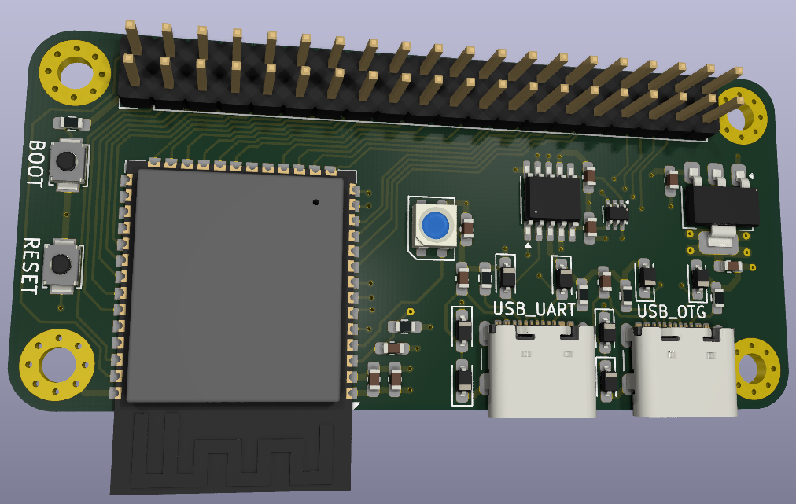

# ESP32-S3 Pi Zero 2 W Development Board

A compact, custom 4-layer development board built around the **ESP32-S3-WROOM-1** module, designed specifically to match the form factor and mounting layout of the **Raspberry Pi Zero 2 W**.



---

## 🚀 Key Features

* **Core Module:** Espressif **ESP32-S3-WROOM-1** (Wi-Fi 802.11 b/g/n and Bluetooth 5 / BLE) with onboard antenna.
* **Form Factor:** Drop-in compatible with Raspberry Pi Zero 2 W mounting holes and physical dimensions.
* **Dual USB-C Connectivity:**
  * **USB OTG:** Direct connection to ESP32-S3 native USB pins.
  * **USB-to-UART:** Built around the **CH343K** serial converter for flashing, debugging, and auto-reset circuitry (via dual NPN transistor configuration).
* **Power Supply:** High-efficiency **LDL1117S33R** 3.3V linear regulator powered via 5V VBUS.
* **Peripherals:** Onboard **WS2812B-Mini** addressable RGB LED for status telemetry.
* **Expansion:** 40-pin GPIO header matching standard Raspberry Pi pinout conventions.
* **Protection:** ESD protection via multiple bidirectional TVS diodes (`LESD3Z5.0C`) on data lines.

---

## ⚙️ Board Stackup (4-Layer PCB)

Designed for optimized signal integrity and solid power/ground planes:
1. **F.Cu (Top Layer):** Components and primary signal routing.
2. **In1.Cu (Internal Plane 1):** Dedicated solid **GND** plane.
3. **In2.Cu (Internal Plane 2):** Power distribution plane (`+3.3V` / `+5V`).
4. **B.Cu (Bottom Layer):** Secondary signal traces and stitching ground paths.

---

## 📂 Repository Structure

```text
├── 3D models/                # STEP models for mechanical enclosures and visualization
├── BOM/                      # Bill of Materials for manufacturing and sourcing
├── CPL/                      # Component Placement List (Pick and Place files)
├── Library/                  # Custom schematic symbols and footprints
├── database/                 # Component database files
├── images/                   # Render previews and visual assets
│   └── ESP32-S3-Pi-Zero-2W.png  # 3D PCB render preview
├── ESP32 S3 Pi Zero 2 W.kicad_pro   # KiCad project file
├── ESP32 S3 Pi Zero 2 W.kicad_sch   # Schematic design file
└── ESP32 S3 Pi Zero 2 W.kicad_pcb   # 4-layer PCB layout file